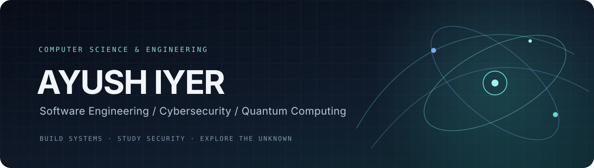
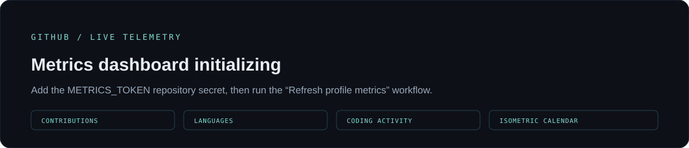

  

  
  
  

  

---

## 01 / About

I am a Computer Science and Engineering undergraduate interested in the mechanics behind modern software — how systems are designed, how applications behave, where security boundaries fail, and how computation changes at the quantum scale.

I like taking ideas from concept to implementation: building practical software, investigating technical behaviour, and documenting the engineering decisions along the way.

**Current direction:** software engineering, application and systems security, and research in quantum computing — particularly quantum error mitigation.

## 02 / Selected Work

<table>
  <tr>
    <td width="50%" valign="top">
      <h3><a href="https://github.com/Ayush-Iyer1611/RogueGuard">RogueGuard</a></h3>
      IDENTITY SECURITY · PYTHON · STREAMLIT
      
A synthetic identity-security lab for identifying excessive service-account permissions, assessing configuration risk, and demonstrating safe containment with test-backed evidence.

    </td>
    <td width="50%" valign="top">
      <h3><a href="https://github.com/Ayush-Iyer1611/spot">SPOT</a></h3>
      WEB ENGINEERING · NEXT.JS · FIREBASE
      
Smart Parking &amp; Organised Ticketing — a project exploring parking workflows, digital tickets, and QR-based verification.

    </td>
  </tr>
  <tr>
    <td width="50%" valign="top">
      <h3><a href="https://github.com/Ayush-Iyer1611/BZR-Pitwall-System">BZR Pitwall System</a></h3>
      FORMULA STUDENT · DATA &amp; DASHBOARDING
      
A motorsport-focused software project connected to Formula Student engineering and race-team data workflows.

    </td>
    <td width="50%" valign="top">
      <h3><a href="https://github.com/Ayush-Iyer1611/handwritten-digit-recognition">Handwritten Digit Recognition</a></h3>
      MACHINE LEARNING · PYTORCH
      
An MNIST-based image-classification project exploring neural-network training and handwritten digit recognition.

    </td>
  </tr>
</table>

  <a href="https://github.com/Ayush-Iyer1611?tab=repositories"><b>Explore all repositories →</b></a>
  &nbsp; · &nbsp;
  <a href="https://github.com/Ayush-Iyer1611/daily-dev-log"><b>Daily Dev Log →</b></a>

## 03 / GitHub Telemetry

  

  Automatically refreshed from public GitHub activity. Language and activity summaries depend on GitHub's available contribution data.

## 04 / Technical Toolkit

  

  Tools I have used across coursework and projects; experience varies by technology.

## 05 / Research &amp; Learning

<table>
  <tr>
    <td><b>Quantum Computing</b></td>
    <td>Quantum algorithms, quantum information, and quantum error mitigation.</td>
  </tr>
  <tr>
    <td><b>Cybersecurity</b></td>
    <td>Application security, Linux security, reverse engineering, and identity governance.</td>
  </tr>
  <tr>
    <td><b>Computer Science</b></td>
    <td>Data structures, algorithms, operating systems, and computer architecture.</td>
  </tr>
</table>

## 06 / Connect

  

  <i>Stay curious. Build deliberately. Understand deeply.</i>

